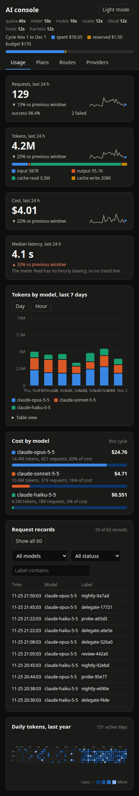
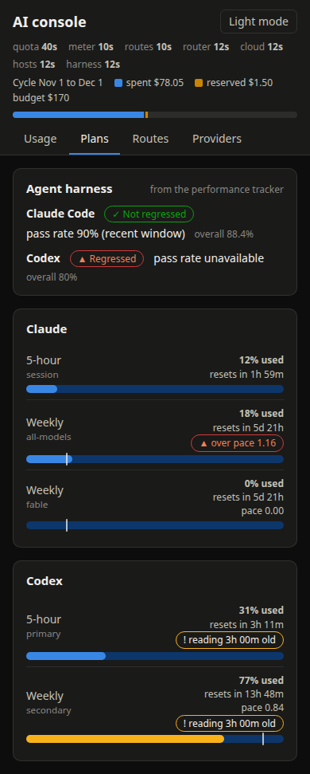
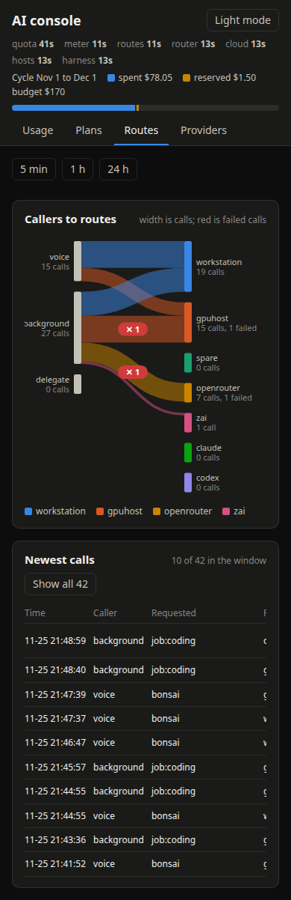
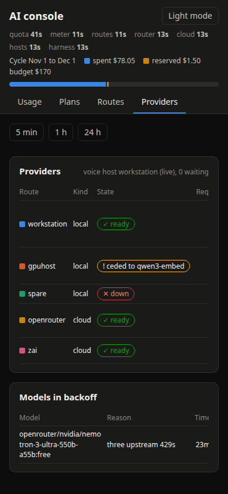

# AI Console

A Home Assistant add-on that shows what the AI tooling is doing on one page: usage and cost, plan limits, where calls go, and how each provider is holding up. It is a single static Rust binary (its own small HTTP server on std) that serves a page with its script and style inline, no CDN and no external fonts. The page is dark by default with a light toggle and works at phone width.

## Views

- Usage: tiles for requests (success rate, failed count), tokens (input, output, cache read, cache write), cost and median latency, each against the previous window with a sparkline; tokens by model over 7 days (day or hour); cost by model; request records with model, label and status filters, collapsed to the newest 10 until you expand the list; a year heatmap of daily tokens; the cycle budget (spent, reserved) in the header.
- Plans: one card per plan with a bar per window, percent used, time to reset and, for weekly windows, the pace (percent used over percent of the window elapsed, a warning above 1.0). Stale readings carry their age. A strip shows Claude Code and Codex pass rate and regressed state from the Agent Harness Performance Tracker.
- Routes: callers (voice, background, delegate) to routes (each local host, each cloud provider, Claude, Codex) as flows with width by call count and a red failure count, over 5 minutes, 1 hour or 24 hours, and the newest calls, collapsed to 10 until you expand the list.
- Providers: one row per local host and cloud provider with requests, success rate, median latency, the last 30 calls, today's usage against the daily limits and the host state (ready, down, ceded), and the models in backoff with time left.

Every view says "no data yet" and the feed's age when its feed is missing, and each feed's age is in the header. An unreachable router is shown as a state.

## Feeds

`docs/feeds.md` is the contract. Three feeds are pushed to `POST /api/feed/{quota,meter,routes}` from the addresses in `push_sources` (none by default: nothing is accepted until you list the sender); the add-on pulls the optional model router's `/routes`, `/cloud` and `/health` every 60 seconds (every 15 seconds while a page is polling) and reads the tracker's Home Assistant entities every 5 minutes. `fixtures/` holds one example of each.

## Install

The repository is an add-on repository: add `https://github.com/heidrickla/ha-ai-console` under Settings, Add-ons, Add-on store, Repositories, then install AI Console. For a local install `HA_SSH=root@<host> bash tools/deploy.sh` copies the add-on folder to `/local_apps` and the Supervisor builds the image there (Rust, for amd64 and aarch64). Options are in `ai_console/DOCS.md`.

## Development

```
cargo nextest run --manifest-path ai_console/console/Cargo.toml
cd tools && npm ci && node page-check.mjs
```

`tools/page-check.mjs` loads the page in jsdom with the fixtures behind a stubbed fetch and checks every view and every no-data state. `tools/local-demo.mjs` serves a mock router and Home Assistant and seeds synthetic history for a local run; set `AI_CONSOLE_EXTRA_PUSH_SOURCES=127.0.0.1` and `AI_CONSOLE_HA_URL` for it.

   
